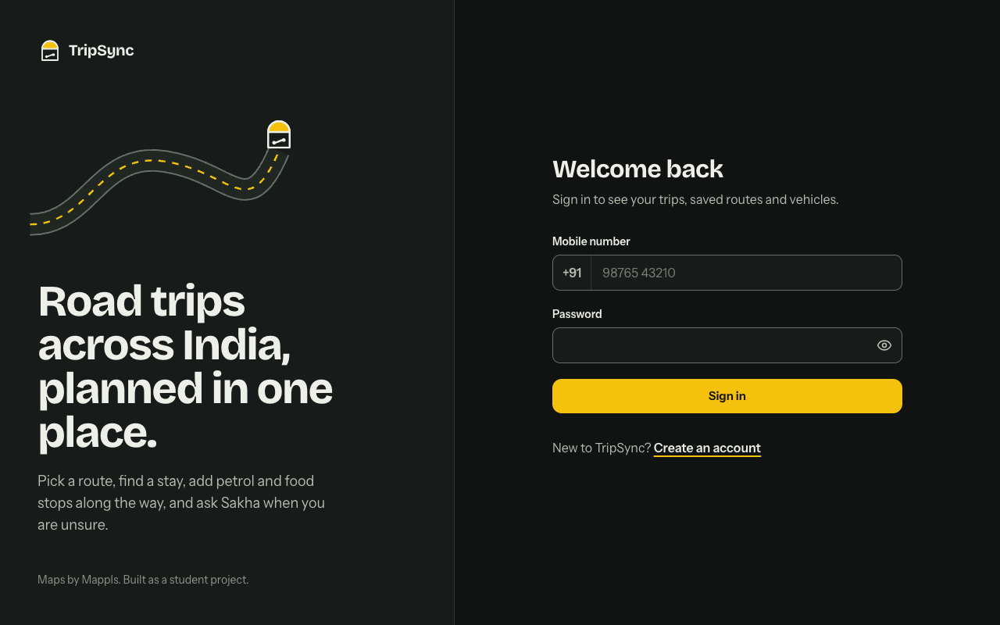
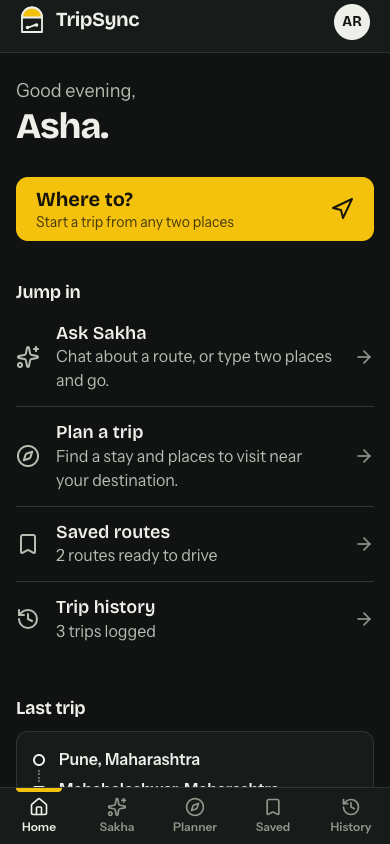
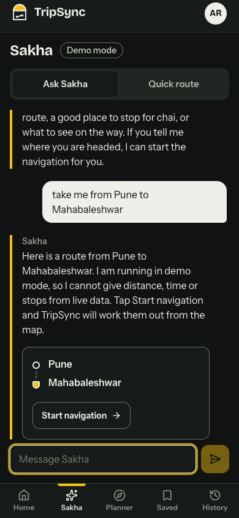
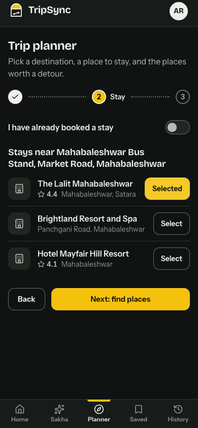
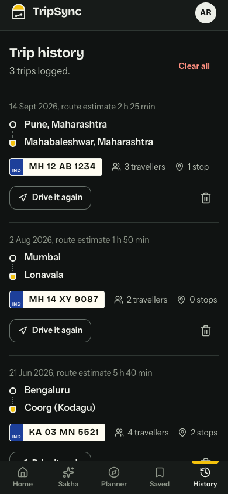
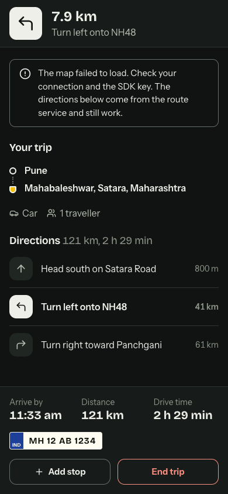
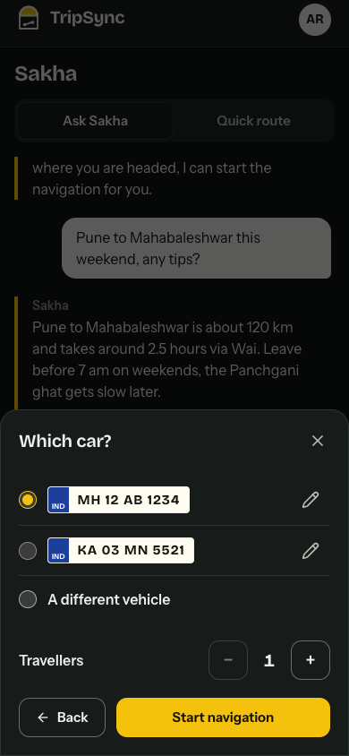

# TripSync

A road trip planner for India. You pick a route, find a stay, add petrol and food stops on the way, and ask Sakha (a Gemini-backed chat assistant) when you are unsure. Trips and saved routes sync to your account.

Live: https://trip-sync-rho.vercel.app

<p>
  
</p>

<p>
  
  
  
  
</p>

<p>
  
  
</p>

The screenshots come from the real production build running against a throwaway mock API with made-up data (Asha Rao and her trips are not real). Sakha is in demo mode in them. The navigation shot is the no-map view, which lists directions when the map SDK is missing or fails to load; map tiles need a Mappls key, so none are shown.

## What it does

- Sign up with a phone number and password, then add your name and vehicles (bikes and cars, with registration numbers).
- Sakha chat. Describe a trip and the reply can include a card that starts navigation. Quick route is the form version, with place suggestions and voice input. Without a Gemini key on the server Sakha runs in a labelled demo mode (see below).
- Trip planner in three steps: destination, stay, places to visit near the stay. Places you add become saved routes.
- Navigation screen with the route on a Mappls map, the next instruction, arrival time, distance and drive time. You can add stops along the way: petrol, food, ATM, EV charging, or any searched place. If the map cannot load, the same screen lists the directions step by step and says why the map is off.
- Installable on a phone (web app manifest and a small offline shell). Safe-area insets and 44px touch targets throughout.
- Trip history. Ending a trip logs it with route, vehicle, travellers and stops. Any past trip or saved route can be started again.
- Account page for your name, vehicles and a light or dark theme.

## Status

I stopped working on this for a while and have now gone through it again. The main fixes are listed in the [commit history](https://github.com/pushpam2404/Trip-Sync/commits/main). Two examples: trip history never got any entries because nothing called the function that saves them, and the navigation screen threw as soon as a route arrived.

What I have checked: both packages typecheck and build, the server and client tests pass, and I clicked through sign-up, sign-in, Sakha, the planner, saved routes, history, account, the trip setup sheets and the navigation screen in a browser at phone and desktop widths. An automated accessibility scan (axe) reported nothing on the main screens in both themes.

What I have not checked: the map and turn-by-turn guidance against a live Mappls account while moving, Sakha against a live Gemini key, and the server against a real MongoDB in this pass. Those need credentials, so treat them as the likeliest places for a remaining bug.

## How it is built

| Part | Tools |
|------|-------|
| Client | React 19, TypeScript, Vite, Tailwind CSS v4, React Router 7, Motion, Lucide icons |
| Server | Node, Express 4, TypeScript, Mongoose, express-validator, helmet, express-rate-limit |
| Data | MongoDB (Atlas free tier in production) |
| Maps | Mappls web SDK for the map, Mappls REST for search and directions |
| AI | Google Gemini through `POST /api/sakha`, so the key stays on the server |

```
client/   React app (screens, components, contexts, services)
server/   Express API (routes, controllers, middleware, models, tests)
docs/     architecture, developer guide, product notes
```

More detail in [docs/SYSTEM_ARCHITECTURE.md](docs/SYSTEM_ARCHITECTURE.md).

## Demo accounts

Open https://trip-sync-rho.vercel.app and sign in with any of these. They all use the password `Demo@1234`, and each has vehicles, past and upcoming trips and saved routes, so the history, saved and account screens have something to show.

| Name | Mobile number | Rides |
| --- | --- | --- |
| Aarav Mehta | `9000000001` | Car and scooter, Pune and Mumbai trips |
| Diya Rao | `9000000002` | Motorcycle, Bengaluru and Coorg trips |
| Kabir Singh | `9000000003` | Car, Delhi to Rajasthan trips |

Sakha runs in demo mode on the live site, so its answers come from a built-in rule-based responder and not from a language model. To load the same accounts into your own database run `MONGO_URI=... npm run seed:demo` in `server/`. It can be repeated safely and refuses to run with `NODE_ENV=production` unless `ALLOW_DEMO_SEED=1` is set.

## Running it locally

You need Node 20 or newer and a MongoDB database.

```bash
git clone https://github.com/pushpam2404/Trip-Sync.git
cd Trip-Sync
npm run install:all

cp server/.env.example server/.env       # fill in MONGO_URI and JWT_SECRET
cp client/.env.example client/.env.local # optional Mappls keys

npm run dev:server   # http://localhost:3001
npm run dev:client   # http://localhost:5173
```

`VITE_API_URL` is required. Without it the app shows a configuration screen and logs the missing name to the console. Without Mappls keys the app still runs: place suggestions are empty, the planner lets you type places, and the navigation screen shows a trip summary with a note.

### Sakha demo mode

Leave `GEMINI_API_KEY` unset and `POST /api/sakha` answers from a small rule-based responder instead of Gemini. It understands "take me from X to Y" (and returns the same route card as the real path), plus petrol, food, ATM, EV charging, stays, tolls and weather questions, and says plainly that it has no live data. The UI shows a "Demo mode" badge. Set the key and the badge disappears; no client change is needed.

### Environment variables

| File | Variable | Needed for |
|------|----------|------------|
| `server/.env` | `MONGO_URI`, `JWT_SECRET` | required, the server will not start without them |
| `server/.env` | `ALLOWED_ORIGINS` | CORS, set to the client URL in production |
| `server/.env` | `GEMINI_API_KEY`, `GEMINI_MODEL` | real Sakha instead of demo mode; the model defaults to `gemini-2.5-flash` (free tier) |
| `client/.env.local` | `VITE_API_URL` | required, API base URL such as `http://localhost:3001/api`; read at build time |
| `client/.env.local` | `VITE_MAPPLS_MAP_SDK_KEY`, `VITE_MAPPLS_REST_API_KEY` | map, search and directions |

The two Mappls keys end up in the browser bundle, which is how Mappls expects them to be used. Restrict them to your domains. The Gemini key is never sent to the browser.

### Scripts

| Command | Does |
|---------|------|
| `npm run dev:server` / `npm run dev:client` | start the dev servers |
| `npm run typecheck` | type-check both packages |
| `npm run build` | build both packages |
| `npm test` | server tests (token handling, validation, CORS, phone normalisation, demo responder) and client tests (route maths, phone normalisation, API error mapping, trip recording, config) |

## Deployment

The live site uses free tiers: the client on Vercel, the API on Vercel, the database on MongoDB Atlas. The settings I use are in the [developer guide](docs/DEVELOPER_GUIDE.md#deployment). The Render free tier sleeps when idle, so the first request after a quiet spell can take a while.

## Known limitations

- Sign-in is a phone number and password with no OTP check.
- The session token is a 30-day JWT kept in `localStorage`. There is no refresh or server-side revocation.
- Walking and train modes use the car route, so their estimates are for a car.
- History stores the route estimate from when the trip ended, not a measured time or distance.
- Distance and drive time on the navigation screen are fixed at the moment the route was fetched.
- The client tests cover the pure logic only. There are no component or end-to-end tests.
- Sakha runs in demo mode until a `GEMINI_API_KEY` is set. I could not test it against a real key.

## Roadmap

1. Run a real drive against the live Mappls API and tighten turn progress.
2. Offline cache for the last route and history.
3. Walking and transit routing.
4. Shared trips and a split-the-costs sheet.

## License

MIT, see [LICENSE](LICENSE).
