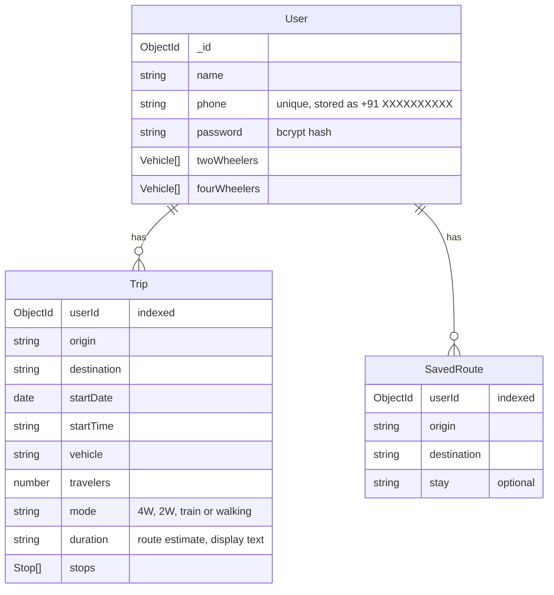
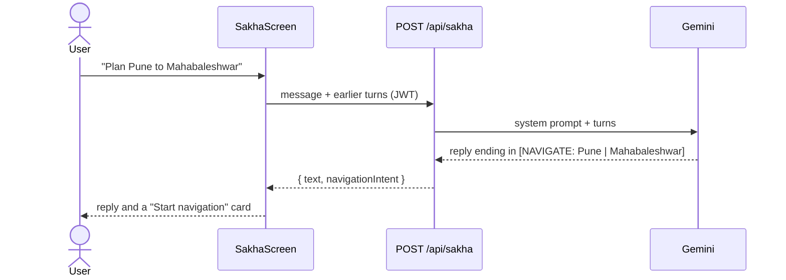

# Architecture

TripSync is a React single-page app talking to an Express API backed by MongoDB. Maps and place search come straight from Mappls in the browser. Sakha, the chat assistant, goes through the API so the Gemini key stays on the server.

```
Browser (React, Vite build, hosted on Vercel)
  |-- Mappls Web SDK         map canvas on the navigation screen
  |-- Mappls REST            place search, geocoding, directions
  |-- TripSync API           /api/auth, /api/trips, /api/saved-routes, /api/sakha
                               |-- MongoDB (Atlas)
                               |-- Gemini (Google AI Studio), Sakha only
```

## Client

`client/src` is organised by role.

| Folder | What lives there |
|--------|------------------|
| `screens/` | One file per page. Every screen is loaded with `React.lazy`, so the login page does not download the map code. |
| `components/ui/` | Small shared pieces: `Sheet` (modal), `PlaceInput` (autosuggest combobox), `Plate`, `RouteLine`, `Notice`, `RoadArt`, icons. |
| `components/layout/` | `AppShell` (side rail on desktop, tab bar on phones) and `AuthLayout`. |
| `contexts/` | Four providers: `Auth`, `Trip`, `Navigation`, `UI`. Composed in `AppProvider`. |
| `services/` | `api.ts` (axios instance), `mapService.ts` (Mappls REST wrappers), `aiService.ts` (Sakha), `location.ts` (browser geolocation). |
| `hooks/` | `usePlaceSuggestions`, `useSpeechToText`, `useMapplsLoader`, `useStartTrip`. |

### Routes

| Path | Screen | Access |
|------|--------|--------|
| `/login`, `/signup` | Sign in, step 1 of sign-up | signed-out only |
| `/profile/setup-1`, `/profile/setup-2` | Sign-up steps 2 and 3 | needs the credentials from step 1 in memory |
| `/` | Home | signed in |
| `/sakha`, `/planner`, `/saved`, `/history` | The four tabs inside the app shell | signed in |
| `/account` | Profile, theme, vehicles | signed in |
| `/navigation` | Live map | signed in, needs a trip in `NavigationContext` |

### State

- `AuthContext` holds the session. The user and JWT are stored in `localStorage` under `tripsync-user`. Sign-up is three screens, and the password lives in a ref between steps 1 and 3, never in storage.
- `TripContext` holds trip history and saved routes. It loads from the API and keeps a copy in `localStorage` as an offline fallback.
- `NavigationContext` holds the origin, destination, mode, vehicle and traveller count for the trip being started or driven.
- `UIContext` holds the theme and which of the two trip-setup sheets is open.
- `services/api.ts` adds the bearer token to requests. When the server answers 401 to a request that carried a token, it fires an event and `AuthContext` signs the user out.

### Starting a trip

Every entry point (Sakha chat card, quick route form, saved route, history, home) calls `useStartTrip(from, to)`. That stores the places and opens the travel-mode sheet. Cars and bikes continue to a vehicle and traveller sheet, then `NavigationContext.startNavigation` moves to `/navigation`. Ending the trip there writes a history entry through `TripContext.addTrip`.

### Navigation screen

`getDirections` calls the Mappls route API and returns a plain `RouteResult` (distance, duration, decoded path, steps). The screen draws the path with the Mappls SDK, watches `navigator.geolocation`, and moves to the next instruction when the device is within 40 m of the next manoeuvre. Distance and drive time are the route estimate at the time it was fetched, not a live countdown.

## Server

`server/src`

| Folder | What lives there |
|--------|------------------|
| `app.ts` | Builds the Express app (helmet, CORS, rate limit, routes, error handler). Importable without listening, which the tests rely on. |
| `index.ts` | Reads `.env`, checks required variables, connects to MongoDB, listens. |
| `routes/` | Route tables with `express-validator` chains. |
| `controllers/` | Handlers. They throw `HttpError`; `asyncHandler` passes rejections to the error handler. |
| `middleware/` | `protect` (JWT), `validateRequest`, `errorHandler`. |
| `models/` | Mongoose schemas. |
| `utils/` | Token signing and phone normalisation. |

### Data model



A vehicle is `{ id, regNumber }`. A stop is `{ name, location: { lat, lng }, stopover }`.

### API

All paths start with `/api`. Errors come back as `{ success: false, message, errors? }`; validation errors list each field in `errors`. Protected routes need `Authorization: Bearer <token>`.

| Method and path | Auth | Purpose |
|-----------------|------|---------|
| `POST /auth/signup` | no | Create an account. Body: `name`, `phone`, `password`, optional `twoWheelers`, `fourWheelers`. Returns the user and a token (201). 409 if the phone is registered. |
| `POST /auth/login` | no | Body: `phone`, `password`. Returns the user and a token. |
| `PATCH /auth/profile` | yes | Update `name`, `twoWheelers`, `fourWheelers`. Returns the user. |
| `GET /trips` | yes | The caller's trips, newest first. |
| `POST /trips` | yes | Log a trip. |
| `PUT /trips/:id` | yes | Replace a trip's fields. 404 if it is not the caller's. |
| `DELETE /trips/:id` | yes | Delete one trip. |
| `DELETE /trips` | yes | Delete all of the caller's trips. |
| `GET /saved-routes` | yes | The caller's saved routes. |
| `POST /saved-routes` | yes | Body: `origin`, `destination`, optional `stay`. |
| `DELETE /saved-routes/:id` | yes | Delete one. |
| `POST /sakha` | yes | Body: `message` (up to 2000 characters), optional `history` (up to 40 turns of `{ role, text }`). Returns `{ text, navigationIntent }`. 503 if `GEMINI_API_KEY` is not set. |
| `GET /health` | no | Liveness check (not under `/api`). |

### Security notes

- Passwords are hashed with bcrypt (10 rounds). Signup requires 8 to 72 characters with upper, lower, digit and symbol.
- Tokens are HS256 JWTs valid for 30 days. The server refuses to start without `JWT_SECRET`; there is no fallback secret.
- `protect` rejects a missing, malformed, expired or bad token, and a token whose user no longer exists.
- Every query on trips and saved routes is scoped to the signed-in user, and update handlers copy a fixed list of fields from the body rather than the whole body.
- Validators insist on strings, so `{ "$gt": "" }` style bodies are rejected before they reach Mongo.
- Rate limits: 300 requests per 15 minutes per client for the API, 10 failed sign-in or sign-up attempts per 15 minutes, 12 Sakha messages per minute per user. `trust proxy` is set to 1 so limits count real clients behind Render.
- CORS only allows the origins in `ALLOWED_ORIGINS`. JSON bodies are capped at 100 KB.

### Sakha flow



The system prompt asks Gemini to end a reply with `[NAVIGATE: Origin | Destination]` when the user wants a route. The server strips the tag and returns it as `navigationIntent`.
